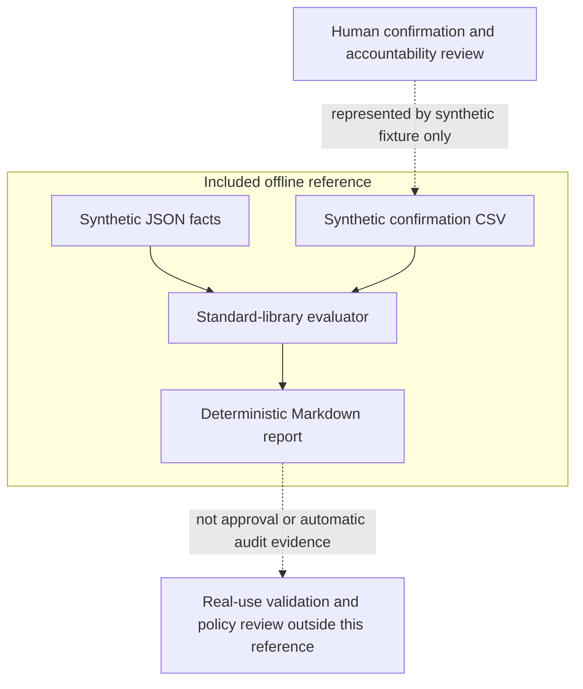

# SSO assessment reference

A small, independently authored **public synthetic reference** for offline SSO onboarding checks. It is not a copy, release or complete reproduction of the historical tenant-connected pilot. No tenant access, credentials, network calls or automated remediation are involved.

The evaluator combines synthetic application facts with a separate synthetic CMDB confirmation CSV. It reports individual PASS / FAIL / REVIEW / UNKNOWN / NOT_APPLICABLE results, **never overall application approval**. Intended criteria extend beyond the implemented subset.

Background: [SSO onboarding standard](https://iam.felixelliott.com/posts/sso-onboarding-standard/).

## Flow



## Files

```text
.
├── .gitignore
├── LICENSE
├── README.md
├── docs/
│   ├── evidence-contract.md
│   ├── recording-frames.md
│   └── images/
│       ├── 01-rule-catalogue-01m18s.png
│       ├── 02-validator-inputs-02m23s.png
│       ├── feature-final-frame.png
│       └── provenance.json
├── examples/
│   ├── assessment-report.md
│   └── onboarding-record.yaml
├── fixtures/
│   ├── cmdb-confirmations.csv
│   └── synthetic-evidence.json
├── src/
│   └── validate.py
├── standard/
│   └── pilot-criteria.md
└── tests/
    └── test_validate.py
```

## Quickstart

From this directory, with Python 3.9+ (standard library only):

```sh
python3 src/validate.py fixtures/synthetic-evidence.json fixtures/cmdb-confirmations.csv --output examples/assessment-report.md
python3 -m unittest discover -s tests -v
```

The first command regenerates the checked-in [example report](examples/assessment-report.md) deterministically. Successful exit means evaluation completed, not that checks passed. Invalid inputs exit 2; an existing report is not deleted on failure. The fixture intentionally includes clean, negative and missing evidence. Results describe only these invented inputs, not a historical run. The [YAML target record](examples/onboarding-record.yaml) is documentation only and is **not loaded**.

## Scope and limits

- Owner presence, independent confirmed service linkage, app/workload credential lifetime and workforce assignment are the executable subset. Owner presence is not independent accountability verification. Candidate linkage never supplies confirmation.
- The 731-day (two-year) lifetime limit is illustrative local synthetic policy, not a universal Microsoft requirement. SSO signing certificates and platform service-principal verification material are distinct and excluded from that rule, not certified healthy.
- Missing facts remain UNKNOWN. Conditional Access coverage is not evaluated; exceptions always need REVIEW. Dates, expiry, rotation, exception approval and lifecycle logic are not implemented. Workload identities do not inherit workforce assignment checks.
- There is no collector, policy engine, remediation, audit-evidence pipeline or overall verdict. Real use requires separate evidence verification and human review.

See the [evidence contract and status meanings](docs/evidence-contract.md) and [intended criteria / implemented mapping](standard/pilot-criteria.md).

[Selected recording frames](docs/recording-frames.md) show historical catalogue and validator workspace context, not successful execution, adoption or this reference's code. The PNGs are unchanged user-selected screenshots from the user's recording; no full video is included.

[MIT](LICENSE) covers newly authored generic code and text, copyright Felix Elliott 2026. The screenshot exclusion does not assert licensing of third-party material.
