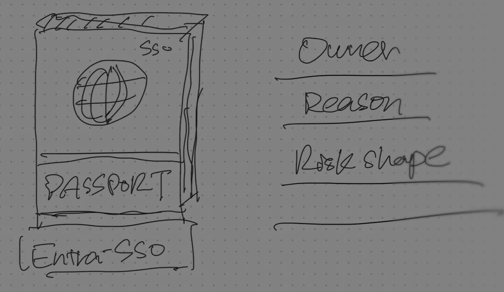
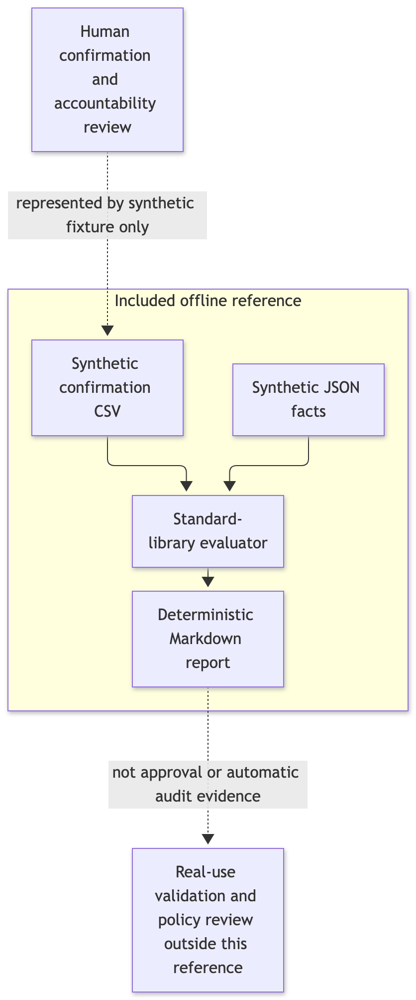

# Screenshots and flow

## A boarding pass for SSO

An owner, a reason and a reviewable risk belong with the application.

## Assessment flow

Synthetic inputs produce per-rule findings. Human confirmation and policy review remain separate. [Mermaid source](reference-flow.mmd).

## Assignment criterion

Assignment is required by default; open access needs approval. The written criterion is broader than the historical validator's implemented check.

## Evidence inputs

Saved evidence and reviewer confirmations feed the checks—not an application approval. These two code screenshots describe the earlier pilot, not the synthetic evaluator in this repo.

[Image provenance and checksums](images/provenance.json).
