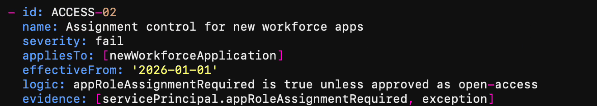
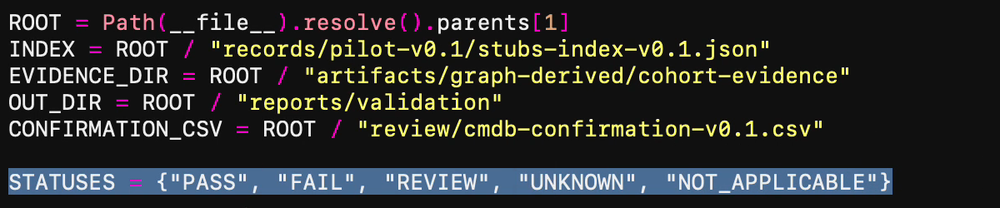
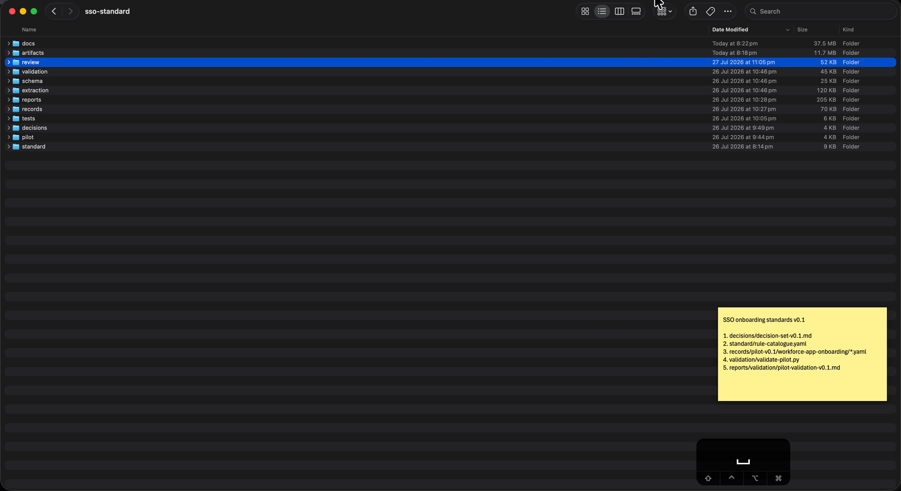

# Selected recording frames

These three user-selected screenshots come from the user's recording `sso-standard-tech.mp4` (3840×2096, variable frame rate, 3137 frames). The video is not included. The supplied review PNGs were copied byte-for-byte; no further crop, redraw or blur was applied here. Frame numbers below are zero-based.

They show historical catalogue/validator paths and workspace context. They do **not** demonstrate successful execution, adoption, current reference code or outcomes. They are illustrative historical media, not inputs or evidence for the synthetic assessment. The MIT grant for newly authored reference code does not purport to license third-party material appearing in screenshots.

## Rule catalogue

Requested 01:18: frame 1134, PTS 77.75 s; supplied crop x=315, y=228, width=1320, height=235. Historical catalogue excerpt, not the implemented subset in this reference.

## Validator inputs

Requested 02:23: frame 1811, PTS 142.966667 s; supplied crop x=310, y=610, width=1200, height=250. Historical validator input/workspace excerpt, not proof of a successful run.

## Final composition

Frame 3136, PTS 207.133333 s; full composition resized to 1920×1048. Historical workspace view, not a report of reference execution. See [checksums](images/provenance.json) for included file integrity.
